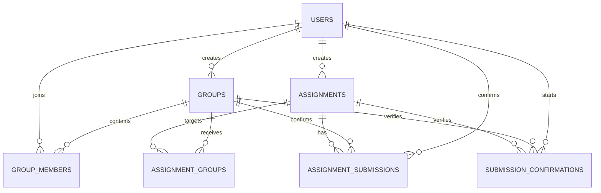
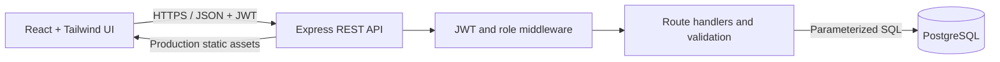

# Joineazy — Student, Group & Assignment Management System

A role-based full-stack application built for the Joineazy Full Stack Intern technical task. Students create groups, add classmates by registered email or student ID, view assignments, open professor-provided OneDrive links, and confirm external uploads through a two-step flow. Professors create and edit assignments, assign them to every group or selected groups, and monitor group-wise and student-wise progress with analytics.

## Technology

- Frontend: React 18, Vite, Tailwind CSS, React Router, Recharts, Lucide React
- Backend: Node.js 20, Express, PostgreSQL, `pg`
- Security: JWT authentication, bcrypt password hashing, role authorization, Helmet, rate limiting, parameterized SQL, Zod validation
- Deployment: Docker, Docker Compose, Render Blueprint

## Features

### Student

- Register and log in with a student role, email and unique student ID.
- Create one group and become its first member.
- Add registered students by email address or student ID.
- View the group's members and leave a group.
- View assignments made available to the student's group.
- Open the OneDrive link supplied by the professor.
- Start a submission confirmation, review a separate confirmation prompt, and explicitly confirm.
- See group submission status and assignment progress.

### Professor / Admin

- Register with the professor role and the configured professor registration code.
- Create and edit assignments with title, description, due date and OneDrive link.
- Assign an assignment to all groups (including groups created later) or selected groups.
- View all groups and their members.
- Inspect assignment progress by group, including members and the confirming student.
- View student-wise and group-wise performance, summary counts and charts.
- Export the student progress table as CSV.

## Project structure

```text
joineazy/
├── backend/
│   ├── src/
│   │   ├── config/       # PostgreSQL connection and schema initialization
│   │   ├── middleware/   # Authentication, authorization and error handling
│   │   ├── routes/       # Auth, groups, assignments and admin APIs
│   │   ├── utils/
│   │   └── server.js
│   └── package.json
├── database/
│   └── schema.sql
├── frontend/
│   ├── src/
│   │   ├── components/
│   │   ├── context/
│   │   ├── pages/
│   │   └── api.js
│   └── package.json
├── Dockerfile
├── docker-compose.yml
├── render.yaml
└── README.md
```

## Run locally with Docker

1. Install Docker Desktop or Docker Engine with the Compose plugin.
2. Copy `.env.example` to `.env` if you want to use the local Node development workflow. Docker Compose includes local database settings in the compose file.
3. From the project root, run:

```bash
docker compose up --build
```

4. Open `http://localhost:5000`.
5. The API health check is available at `http://localhost:5000/api/health`.
6. Stop the stack with `docker compose down`. Keep the named database volume unless you intentionally want to remove local data. To remove it, run `docker compose down -v`.

The database schema is applied automatically when the PostgreSQL volume is first created. If you need to initialize an existing local database manually, run `npm run db:init --prefix backend` after setting `DATABASE_URL`.

## Run locally without Docker

Requirements: Node.js 20+, npm, and PostgreSQL 14+.

1. Create a PostgreSQL database named `joineazy`.
2. Copy `.env.example` to `.env` in the project root and set `DATABASE_URL`, `JWT_SECRET`, and `ADMIN_REGISTRATION_CODE`.
3. Initialize the schema:

```bash
cd backend
npm install
npm run db:init
```

4. In a second terminal, start the API:

```bash
cd backend
npm run dev
```

5. In another terminal, start the frontend:

```bash
cd frontend
npm install
npm run dev
```

6. Open `http://localhost:5173`.

The Vite development server proxies `/api` requests to `http://localhost:5000`, so the frontend can use the default API base path without extra environment configuration.

## Render deployment

The repository includes `render.yaml` and a root Dockerfile. The Docker image serves the compiled React application and the Express API from the same web service. PostgreSQL is provisioned as a separate Render database.

1. Push this repository to GitHub.
2. In Render, choose **New + → Blueprint** and connect the repository.
3. Review the `joineazy-db` and `joineazy-app` resources and deploy.
4. When prompted, set `ADMIN_REGISTRATION_CODE` to a private value. Do not use the sample value in a public deployment.
5. The blueprint generates `JWT_SECRET` and injects the internal PostgreSQL connection string.
6. Once deployed, open the service URL. Check `/api/health` to confirm the database connection.
7. Register a professor account using the private registration code. Register student accounts with unique student IDs.

If the service is created manually instead of using the Blueprint, configure:

- Runtime: Docker
- Dockerfile path: `./Dockerfile`
- Docker context: `.`
- `NODE_ENV=production`
- `DATABASE_URL`: Render PostgreSQL **internal** connection string
- `JWT_SECRET`: long, random secret
- `ADMIN_REGISTRATION_CODE`: private professor sign-up code
- `PORT`: Render supplies this automatically; the server also defaults to `5000`

The API and frontend are served from the same Render origin, so the frontend uses the relative `/api` base path. The Docker startup command applies the schema before starting the API, so a newly provisioned PostgreSQL database is initialized automatically. The schema uses `CREATE TABLE IF NOT EXISTS`, so restarting the service does not recreate existing tables.

Do not expose the database's external connection string or the professor registration code in frontend environment variables or GitHub.

## API reference

All protected endpoints require `Authorization: Bearer <JWT>`.

| Method | Endpoint | Access | Purpose |
|---|---|---|---|
| POST | `/api/auth/register` | Public | Register student or professor |
| POST | `/api/auth/login` | Public | Log in and receive JWT |
| GET | `/api/auth/me` | Authenticated | Get current user |
| GET | `/api/groups` | Authenticated | List visible groups |
| POST | `/api/groups` | Student | Create group |
| POST | `/api/groups/:groupId/members` | Student group member | Add student by email or ID |
| DELETE | `/api/groups/:groupId/members/:userId` | Student group member | Remove another group member |
| DELETE | `/api/groups/:groupId/leave` | Student | Leave a group |
| GET | `/api/assignments` | Authenticated | List assignments and status |
| POST | `/api/assignments` | Professor | Create assignment |
| PUT | `/api/assignments/:id` | Professor | Edit assignment and target groups |
| DELETE | `/api/assignments/:id` | Professor | Delete assignment |
| GET | `/api/assignments/:id/progress` | Professor | Get group-wise assignment status and members |
| POST | `/api/assignments/:id/groups/:groupId/confirmation/start` | Student group member | Start first confirmation step |
| POST | `/api/assignments/:id/groups/:groupId/confirmation/confirm` | Student group member | Complete second confirmation step |
| GET | `/api/admin/analytics` | Professor | Summary, group and student analytics |
| GET | `/api/admin/students` | Professor | List students and group membership |
| GET | `/api/health` | Public | Service and database health check |

### Important request examples

Student registration:

```json
{
  "fullName": "Aarav Patel",
  "email": "aarav@example.edu",
  "studentId": "CS2026001",
  "password": "a-strong-password",
  "role": "student"
}
```

Professor registration:

```json
{
  "fullName": "Dr. Mehta",
  "email": "professor@example.edu",
  "password": "a-strong-password",
  "role": "admin",
  "adminCode": "your-private-registration-code"
}
```

Create an assignment for all groups by sending an empty `groupIds` array. To target selected groups, send their numeric IDs:

```json
{
  "title": "Database Management Project",
  "description": "Complete the project and upload the final files to the shared OneDrive folder.",
  "dueDate": "2026-12-01T18:00:00.000Z",
  "oneDriveLink": "https://onedrive.live.com/",
  "groupIds": []
}
```

## Database schema and relationships

- `users`: students and professors, with unique email and optional unique student ID.
- `groups`: student-created teams, each linked to its creator.
- `group_members`: many-to-many group membership, with a unique user constraint so a student can belong to one group at a time.
- `assignments`: professor-created work and OneDrive submission URL.
- `assignment_groups`: selected-group assignment targeting. No rows for an assignment means it is available to all groups, including future groups.
- `assignment_submissions`: one final confirmation per assignment and group.
- `submission_confirmations`: short-lived, single-use confirmation tokens for the first and second step.



## Architecture and request flow



The browser stores the JWT and attaches it to protected API requests. Express verifies the token and checks the role before executing protected operations. Route handlers use parameterized PostgreSQL queries. Foreign keys and unique constraints enforce relationships and prevent duplicate group membership and duplicate final submission confirmations. The professor analytics endpoint aggregates group and student progress in the database. OneDrive stores the actual uploaded assignment files; this application stores the professor's shared link and the group's confirmation record, as specified in the task.

## Design and deployment decisions

- PostgreSQL is used as required by the assignment. The schema uses foreign keys, uniqueness constraints and indexes for relational integrity.
- A student can belong to one group at a time. A student who is already in a group must leave before creating or joining another.
- An assignment with no `assignment_groups` rows is assigned to all groups, including groups created after the assignment. A non-empty set targets only those groups.
- The submission confirmation token expires after ten minutes and can be used once. The final submission row is unique per assignment and group.
- The professor registration code prevents unrestricted public creation of professor accounts. Set a private value in deployment configuration.
- Passwords are hashed with bcrypt. JWTs expire after seven days. API responses never return password hashes.
- OneDrive upload itself remains external; the application does not claim to inspect OneDrive files. A group member records the team's confirmation after uploading externally.
- The root Dockerfile builds the frontend and packages it with the API. Render serves the compiled frontend and API from one web service, avoiding cross-origin production configuration.

## Before submission

- Replace the sample professor registration code with a private deployment secret.
- Test student registration, group creation, adding a member, assignment visibility, OneDrive link opening, both confirmation steps, professor assignment editing, and analytics.
- Add the GitHub repository URL, deployed platform URL and a short demo video URL to the PDF requested by the task instructions.
- Keep the repository's commit history meaningful; commit the project in logical milestones rather than as one unexplained final commit.
